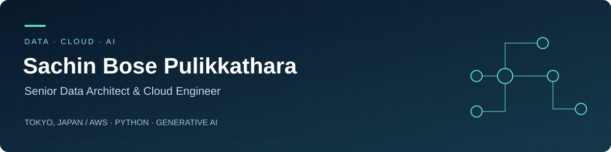

  <a href="https://www.linkedin.com/in/sachin-bose-p/">LinkedIn</a> ·
  <a href="mailto:sachin.bose.p@gmail.com">Email</a> ·
  <a href="https://aegis-ten-phi.vercel.app">Aegis</a> ·
  <a href="PROJECTS.md">All projects</a> ·
  <a href="EXPERIENCE.md">Full experience</a> ·
  <a href="sachin_bose_cv.html">CV source</a>

## About me

I'm Sachin, a **Senior Data Architect & Cloud Engineer** based in **Tokyo, Japan**, with **12+ years of experience** across data engineering, enterprise software, and technical leadership. I build cloud data platforms and use Generative AI to automate the engineering work around them.

At **IBS Software**, I work on **Bluelake, the airline PSS Data Warehouse for ANA (All Nippon Airways)**: AWS Glue and Redshift pipelines processing **5M+ records daily**, dimensional and semantic data models, self-healing workflows, and GenAI-assisted ETL development.

Alongside my professional work, I build AI engineering tools, airline applications, and SaaS products. My background spans SQL Server database engineering, C#/.NET enterprise applications, TypeScript frontend frameworks, and AWS data architecture.

**Open to:** Data Architect, Cloud Architect, and AI Engineering leadership roles. Based in Tokyo; visa sponsorship not required.

## Major projects

Enterprise work and substantial product platforms come first. The [complete project catalog](PROJECTS.md) includes all **42 repositories**, with smaller tools, experiments, and starter projects after the larger platforms. Private source links require repository access.

### 01 · Bluelake — Airline PSS Data Warehouse

**Professional work · IBS Software / ANA · Mar 2024–Present**

Enterprise data warehousing that turns passenger services data into trusted analytics. My work covers ETL architecture, dimensional and semantic models, event-driven orchestration, governance, predictive analytics, and self-service BI. Related work includes a Bedrock tool that generates ETL code from business requirements and self-healing workflows built with Lambda and Step Functions.

**Stack:** Python · PySpark · AWS Glue · Amazon Redshift · Lambda · Step Functions · SageMaker · Bedrock · QuickSight · Power BI

[Professional project details](EXPERIENCE.md#professional-projects)

### 02 · Aegis — AI Engineering Workspace

An engineering workspace connecting issue trackers, Git repositories, and AI models. Coding, testing, and management assistants take a ticket through planning, implementation, tests, security checks, and review, with human approval. Supports cloud providers and local models through Ollama.

**Stack:** Python · FastAPI · React · PostgreSQL / pgvector · Docker · Ollama

[Public product portal](https://aegis-ten-phi.vercel.app) · [Repository — private](https://github.com/sachin-bose-p/aegis)

### 03 · NILSWA Enterprise Cloud — Multi-Portal Platform

A platform with a public customer portal, an internal enterprise CRM, onboarding workflows, and a FastAPI backend. The wider NILSWA portfolio includes products for insurance, real estate, education, and senior care.

**Stack:** Next.js · TypeScript · Python · FastAPI · SQLAlchemy

[Website](https://nilswa.vercel.app) · [Repository — private](https://github.com/sachin-bose-p/nilswa)

### 04 · NilSwa Trade AI — Research & Paper Trading Workspace

An Indian-market research workspace combining a dashboard, Python worker, deterministic research agents, PostgreSQL, and a read-only ChatGPT MCP endpoint. The documented defaults use paper trading with real-money execution disabled; broker and external acceptance checks remain separate gates.

**Stack:** Next.js · React · TypeScript · Python · FastAPI · PostgreSQL · Docker

[Repository — private](https://github.com/sachin-bose-p/nilswa-trade-ai)

### 05 · FlyVectra — Airline Operations Platform

A multi-tenant airline operations platform. Its AeroStation module detects gate and stand conflicts and proposes reallocations for a duty manager to approve. Tenant isolation and role-based access support the operational workspace.

**Stack:** Python · PostgreSQL · LangGraph

[Repository — private](https://github.com/sachin-bose-p/fly-vectra)

### 06 · NaviQ FlightLink — Airline Integration Hub

An integration platform that validates incoming JSON/CSV flight data, maps it into iFlight XML, and handles delivery with retries and a dead-letter queue. Includes a tenant-scoped dashboard and mapping tools.

**Stack:** TypeScript · Fastify · React · PostgreSQL · Redis · Docker

[Repository — private](https://github.com/sachin-bose-p/naviq-flightlink)

### 07 · IATA TTBS — Ticket Tax Box Service Project

A ticket tax, fee, and charge rules project with multi-agent extraction, a visual rule builder, itinerary simulation, partner feed distribution, and an audit trail.

**Stack:** React · TypeScript · FastAPI · LangGraph · PostgreSQL / pgvector

[Repository — private](https://github.com/sachin-bose-p/iata-ttbs)

### 08 · WealthPilot AI — Personal Wealth Workspace

A local-first workspace for investments, assets, liabilities, income, expenses, and transactions. Includes portfolio analytics, cash-flow dashboards, forecasting, and configurable alerts, with JSON persistence.

**Stack:** React · TypeScript · ECharts · Python · FastAPI · Pydantic

[Repository — private](https://github.com/sachin-bose-p/WealthPilot-AI)

### More platforms and products

| Project | Focus | Source |
| :--- | :--- | :--- |
| **AegisCore / O.R.I.O.N.** | Local-first AI, DevOps, and Agile workspace with a companion agent, knowledge bases, and desktop packaging | [Private](https://github.com/sachin-bose-p/aegis-core) |
| **Airline Crew CRM & ERP** | Crew management, rostering, duties, and leave with React, FastAPI, and PostgreSQL | [Private](https://github.com/sachin-bose-p/crew) |
| **SchoolHub** | Multi-tenant education platform with CRM, academic operations, and a website builder | [Private](https://github.com/sachin-bose-p/schoolhub) |
| **NILSWA Insurance Hub** | Insurance-agent CRM, policy tracking, lead pipelines, and branded websites | [Private](https://github.com/sachin-bose-p/nilswa-insurance-hub) |
| **NILSWA Realty** | Real estate CRM and customer portal for properties, leads, and tour bookings | [Private](https://github.com/sachin-bose-p/nilswa-realty) |
| **NILSWA SeniorCare** | Senior-care CRM with resident, staff, and shift management | [Private](https://github.com/sachin-bose-p/nilswa-seniorcare-enterprise) |
| **iFlight MRO & Supply Chain** | Professional contributions to maintenance, work orders, component tracking, and compliance reporting | [Experience](EXPERIENCE.md#professional-projects) |
| **Realtor Web Platforms / Realtor Websites** | Professional database, backend, and frontend engineering for real estate applications | [Experience](EXPERIENCE.md#professional-projects) |

## Smaller tools, demos & experiments

| Project | Focus | Source |
| :--- | :--- | :--- |
| **NILSWA Chat Deck** | Local-first chat workspace with cloud/local model routing and streaming responses | [Private](https://github.com/sachin-bose-p/nilswa-chat-deck) |
| **FluxHub Stream Engine** | Message ingestion and orchestration project for SQS/SNS, RabbitMQ, and Kafka | [Private](https://github.com/sachin-bose-p/fluxhub-stream-engine) |
| **IBS Coding Buddy** | AI coding-assistant project linking tickets, chat, repositories, and pull requests | [Private](https://github.com/sachin-bose-p/ibs-coding-buddy) |
| **iCrew & iCrewService** | Airline crew dashboard and companion backend | [Dashboard — private](https://github.com/sachin-bose-p/iCrew) · [Service — private](https://github.com/sachin-bose-p/iCrewService) |
| **Desktop Stock Alert** | Local Indian stock-market monitor and desktop alerts | [Private](https://github.com/sachin-bose-p/desktop-stock-alert) |
| **AWS Glue Job Demo** | Glue job sample with a deployment template | [Private](https://github.com/sachin-bose-p/aws-gluejob-demo) |
| **Local LLM Setup** | Python scripts for trying local language models | [Private](https://github.com/sachin-bose-p/nilswa-local-llm-setup) |
| **Personal Portfolio** | Responsive HTML/CSS/JavaScript portfolio with theme switching | [Private](https://github.com/sachin-bose-p/personal-portfolio) |

**[Browse all 42 repositories, including concepts, support packages, and starter projects →](PROJECTS.md)**

## Technology

| Area | Technologies |
| :--- | :--- |
| **Data engineering** | Python, PySpark, Pandas, ETL/ELT, data warehousing, dimensional and semantic modeling, SSIS |
| **AWS & cloud** | Redshift, Glue, Lambda, Step Functions, SageMaker, Bedrock, S3, EC2, CloudFormation; Microsoft Azure |
| **AI & automation** | Generative AI, LLM integration, predictive analytics, natural-language querying, local models, agent workflows |
| **Databases** | MS SQL Server, PostgreSQL, Amazon Redshift, Oracle, MySQL, T-SQL, PL/SQL |
| **Backend** | C#, .NET Framework, .NET Core, ASP.NET MVC, REST APIs, Web API, Python/FastAPI, Node.js |
| **Frontend** | Angular, React, Next.js, TypeScript, JavaScript, HTML, CSS, jQuery, XML, Webpack |
| **Analytics** | Amazon QuickSight, Power BI, Google Analytics, business intelligence dashboards |
| **Delivery** | Git, SVN, Bitbucket, GitHub Actions, Jenkins, Docker, CI/CD, Windows Server, shell scripting, Agile/Scrum, code review |

[All 28 LinkedIn-listed skills →](EXPERIENCE.md#linkedin-skills)

## Career

| Dates | Role | Organization |
| :--- | :--- | :--- |
| Jul 2025–Present | **Senior Technical Architect** · Tokyo | IBS Software |
| Mar 2024–Jun 2025 | **Technical Architect** · Tokyo | IBS Software |
| Jun 2022–Mar 2024 | **Lead Solutions Architect** · Kochi / Remote | IBS Software |
| Aug 2019–Jun 2022 | **Senior Software Development Engineer** · Frontend framework engineering | Datafloat Technologies India Pvt Ltd |
| Apr 2016–Aug 2019 | **Senior Software Development Engineer** · Full-stack web platforms | Datafloat Technologies India Pvt Ltd |
| Apr 2012–Mar 2016 | **Database Software Engineer** | Datafloat Technologies India Pvt Ltd |

[Responsibilities, professional projects, and all eight awards →](EXPERIENCE.md)

## Recognition, education & languages

- **1st prize, Generative AI Hackathon — ANA Systems & IBS Software, Jan 2025:** Airline Crew Fitness & Readiness Optimizer.
- **Eight LinkedIn-listed honors:** Department Champ, Customer Champ, Excellence Award, and the hackathon win, spanning Sep 2022–May 2025.
- **B.Sc. Computer Science**, St. Thomas College, Thrissur, 2009–2012.
- **Higher Secondary, Biology / Science**, Paramekkavu Devaswom College, Thrissur, 2007–2009.
- **Languages:** English, Hindi, Malayalam, Tamil.

## Connect

I'm interested in data platforms, cloud architecture, AI engineering, and enterprise modernization.

[LinkedIn](https://www.linkedin.com/in/sachin-bose-p/) · [sachin.bose.p@gmail.com](mailto:sachin.bose.p@gmail.com) · **Tokyo, Japan**

Profile rebuilt October 2026 using my LinkedIn profile, CV, and repository documentation. Project descriptions summarize documented scope; concepts and starter repositories are identified in the full catalog.
