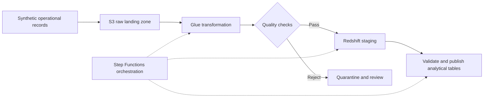

# Reliable AWS Data Pipelines — Architecture Note

**Sachin Bose Pulikkathara · Independent reference design · Synthetic example**

[GitHub profile](../README.md) · [Project catalog](../PROJECTS.md)

This note explains a design approach for batch analytics pipelines using Python, AWS Glue, Amazon Redshift, and Step Functions. It is an independent reference example, with no employer system details or production performance claims.

## Design problem

Turn incoming operational records into consistent analytical tables while making failures visible, recoverable, and safe to replay. Successful execution alone is insufficient: data must also meet the intended contract.

## Proposed flow

## Decisions that matter

**Retain an input reference.** Record a batch identifier and source reference before transformation. Keep raw inputs available for a defined retention period so an operator can trace and reproduce a result.

**Make replay safe.** A retry must not silently duplicate analytical records. Define business keys and version rules, validate a batch in staging, and use an appropriate transactional update/insert strategy. Redshift documents loading and staging-table approaches in its [data loading guidance](https://docs.aws.amazon.com/redshift/latest/dg/c_loading-data-best-practices.html) and [update/insert guidance](https://docs.aws.amazon.com/redshift/latest/dg/t_updating-inserting-using-staging-tables-.html).

**Treat quality as a publication decision.** Check required values, types, allowable values, business-key uniqueness, and freshness. Define which failures quarantine a row and which stop publication of the entire batch. [AWS Glue Data Quality](https://docs.aws.amazon.com/glue/latest/dg/tutorial-data-quality.html) provides ruleset-based evaluation within ETL workflows.

**Retry transient failures deliberately.** Use bounded retries and backoff for retryable errors, and explicit catch paths for failures needing intervention. A deterministic validation failure should enter a review path rather than repeatedly rerun unchanged data. See [Step Functions error handling](https://docs.aws.amazon.com/step-functions/latest/dg/concepts-error-handling.html).

## Synthetic acceptance example

| Input | Condition | Intended handling |
| --- | --- | --- |
| Record A, version 1 | Complete and valid | Eligible for staging |
| Record B, version 1 | Missing a required business key | Quarantine with a reason |
| Record A, version 1 again | Duplicate record/version | Deduplicate according to the stated contract |
| Record A, version 2 | Valid later update | Apply the agreed version/update rule |

Expected behavior depends on an explicitly defined data contract. The example illustrates decisions to test; it is not a measured run or a deployed implementation.

## Operational evidence to collect

For each batch, capture input, accepted, rejected, deduplicated, and published counts; the quality-rule results; the relevant timestamps; and the execution status. Reconcile those counts against the transformation's documented semantics. Track runtime, recovery effort, freshness, and cost over consistent windows before claiming an improvement.

The central principle is simple: make the data contract, replay behavior, and publication boundary explicit, then test the failure paths as carefully as the success path.

**Published October 2026.** Reference architecture only; no AWS resources are provisioned by this document.
