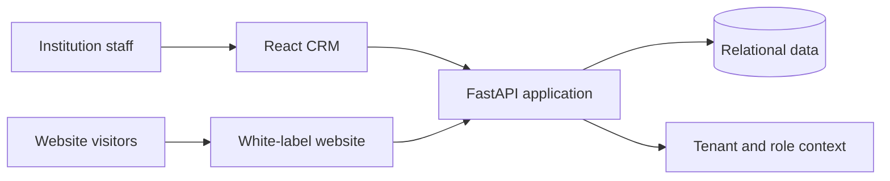

# SchoolHub — Multi-tenant Education Platform

**Sachin Bose Pulikkathara · Independent project · Implementation case study**

[GitHub profile](../README.md) · [Project catalog](../PROJECTS.md)

## Problem

Educational institutions need to manage staff, students, academic operations, and public website content without maintaining disconnected applications for every task. A shared platform also needs clear separation between institutions and appropriate access for administrators, teachers, students, and parents.

## My work

SchoolHub is my independent education-platform project. Its documented implementation combines a React CRM, a Python/FastAPI backend, relational data storage, and a separate white-label website renderer. This case study describes that repository's architecture and documented scope.

## Architecture

The backend exposes authentication, CRM, and content-management routes. Tenant identity and role checks are intended to govern access to institution data. The CRM and website renderer are separate frontends, allowing staff workflows and public presentation to evolve independently.

## Documented capabilities

- Staff, student, and parent records with role-oriented CRM views.
- Academic operations including attendance, examinations, grades, fees, and leave.
- Website configuration and content management from the CRM.
- A public renderer that resolves an institution's website configuration.
- A modular SQL schema and a Docker Compose development setup.

**Technology:** Python, FastAPI, SQLAlchemy, PostgreSQL, React, TypeScript, Vite, Tailwind CSS, and Docker.

## Design decisions and trade-offs

| Decision | Purpose | What needs careful validation |
| --- | --- | --- |
| Shared application and data platform | Reuse common operations across institutions | Enforce tenant boundaries consistently in every relevant query and endpoint |
| Separate CRM and public website | Keep internal operations distinct from public content delivery | Define which fields and content are permitted to reach the public renderer |
| Configuration-driven website | Support institution-specific content without separate application forks | Validate configuration and preserve a usable default presentation |
| Modular database objects | Make the data model easier to navigate and change | Keep schema migrations repeatable and compatible with application changes |

## Illustrative workflow

A fictional institution, **Example Academy**, records a student's attendance through the staff CRM. The backend handles the request in that institution's context. A separate website visitor reads published admissions content through the public renderer. The website should expose published content while staff records remain within the operational application.

This is a synthetic scenario; it contains no real student or institution data.

## Current status

The repository contains application components and local development instructions. This case study does not assert a public production deployment, customer adoption, independent security certification, or measured performance results. Production-readiness work should include tenant-isolation tests, authorization review, removal of development authentication shortcuts, backup/restore verification, and operational monitoring.

**Published October 2026.** Source code remains private; this public case study summarizes documented functionality without exposing credentials or customer information.
